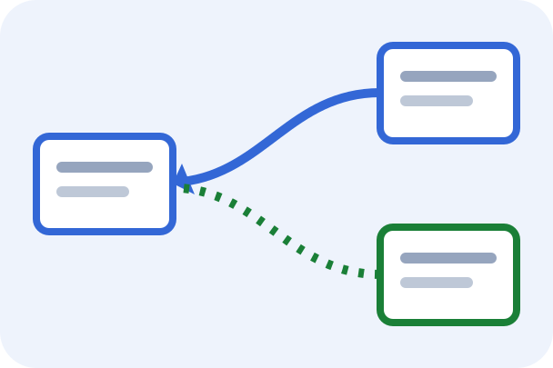
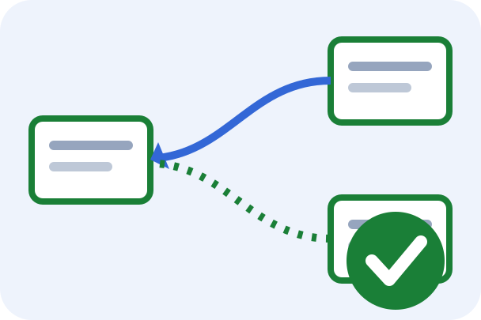
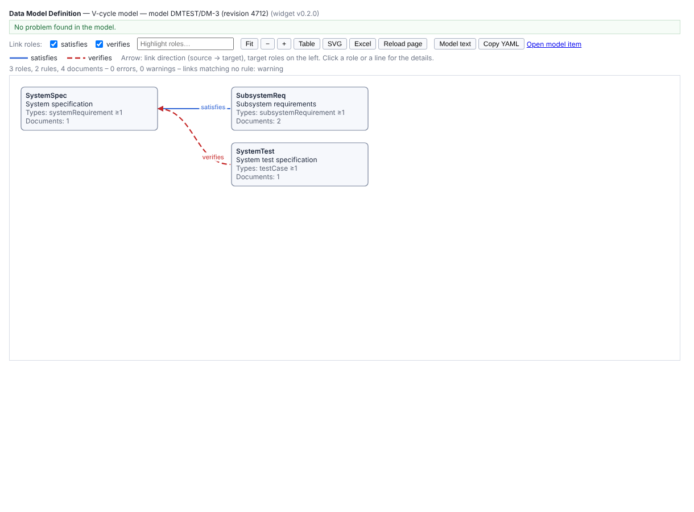

# Polarion data model checker

Siemens Polarion **LiveReport widgets** to formalize the **data model** of a project and check the real data against it.

| Widget | Purpose | Status | Docs |
|---|---|---|---|
|  **dmDefine** — Data Model Definition | A key user / project admin formalizes the main documents (roles), the work item types each must contain and the links between them (e.g. V-cycle: `satisfies`). Shows the model as a graph and tables, validates it against the project configuration, lists the problems with their line | **0.6.0** (0.5.0 **verified on Polarion 2512**; 0.6.0 = severity per side of a rule; 0.2.0 = document pairs, 0.3.0 = form editor, 0.4.0 = `uses:` and documents of other projects, 0.5.0 = Save to Polarion (REST); [checks](docs/PO_CHECKS.md)) | [install](docs/dmDefine/install.md) · [specification](widgets/dmDefine/SPECIFICATION.md) |
|  **dmCheck** — Data Model Check | Checks the declared documents, items and links against the model: required item types, required links per item (pooled or paired documents), unexpected types and links. Graph coloured by compliance, report table, Excel, PDF | **0.3.0** (0.1.0 **verified on Polarion 2512**; 0.3.0 = severity per side of a rule; 0.2.0 = drill-down: open the violating items in Polarion's work item table, built and tested on mocks; [checks](docs/PO_CHECKS.md)) | [install](docs/dmCheck/install.md) · [specification](widgets/dmCheck/SPECIFICATION.md) |



The model is a **YAML** text in the description of a work item of a dedicated LiveDoc. Format:
[docs/DATA_MODEL_FORMAT.md](docs/DATA_MODEL_FORMAT.md); **how to model common cases, with examples**
(V-cycle chain, several documents per role pooled or paired, hierarchy):
[docs/MODELING_GUIDE.md](docs/MODELING_GUIDE.md). The two widgets are independent, so dmCheck can be tested with a
hand-written dummy model.

## Principles

- Target **Polarion 2512**, compatible with **2612** (not verified yet).
- Deployed by a Polarion admin as Velocity widget zips (Administration → Velocity Widgets); no server-side extension.
- Editing the model: form editor, then copy/paste into the model work item, or *Save to Polarion* through the REST API
  when it is available (optional, copy/paste always works).
- Developed **incrementally**: specification → architecture → spikes on a real instance → implementation, one widget at a time.

## Status and plan

This repository was started from [polarion_branches_copies_widget](https://github.com/borisboiakki/polarion_branches_copies_widget)
(docBranches, docCoverage, advImpact), whose Polarion knowledge, build tooling and client core it reuses.

1. Specifications of both widgets and the model format (**draft, open questions listed**).
2. Preliminary architecture: [docs/ARCHITECTURE.md](docs/ARCHITECTURE.md) (**draft, to be revised after the spikes**).
3. Spikes with diagnostic widgets in `tests/`: **dmSpike** ([run sheet](tests/dmSpike-v0.1.x/spike-tests.md)) for the
   model item, the YAML parser in Velocity, bindings, configuration and REST (**done on 2512: model reading, parser, configuration and REST GET/PATCH confirmed**); SQL of the checks later.
4. **dmDefine**: 0.1.0 (read, validate, show), 0.2.0 (document pairs), 0.3.0 (form editor) and 0.4.0 (`uses:`,
   documents of other projects), 0.5.0 (Save to Polarion through REST) built; checks to run on 2512: [docs/PO_CHECKS.md](docs/PO_CHECKS.md); the next dmDefine increments are listed
   in its specification (§8). **dmCheck 0.1.0** built (v1 checks on SQL forms verified on 2512; faster set queries and
   drill-down measured by dmSpike S10).

## Repository contents

| Path | Purpose |
|---|---|
| `CLAUDE.md` | Instructions for Claude Code: workflow, rules, Polarion facts verified on 2512 |
| `Polarion_Development_Guide.md` | Polarion development best practices (copied from the sister repo) |
| `docs/DATA_MODEL_FORMAT.md` | Format of the model YAML (keys, defaults, validation, planned `pairs`) |
| `docs/MODELING_GUIDE.md` | User guide: use cases with example models |
| `docs/PO_CHECKS.md` | Ordered list of the checks still to run on Polarion 2512 |
| `docs/ARCHITECTURE.md` | Preliminary architecture (model pipeline, parser, checks, page model, spikes) |
| `docs/reference/` | Architecture of the sister widgets (reference for the reused parts) |
| `widgets/<widget>/SPECIFICATION.md` | Requirements, decisions, spikes and open questions of each widget |
| `shared/` | Client core, Velocity snippets, Excel library: **copied** from the sister repo, to be adapted |
| `widgets/<widget>/src/`, `dist/`, `VERSION` | Widget sources, generated package (`dist/<widget>.zip`, committed), version |
| `docs/<widget>/` | Install guide, previews, icon source |
| `tools/` | `build-widget.py`, `test-widget.sh`, `test-spikes.sh`, `vcheck.sh`; harnesses and mocks in `tools/vtest/` (`dmmocks/` for this repo, `mocks/` copied from the sister repo) |
| `tests/dmSpike-v0.1.x/` | Spike widget and run sheet for dmDefine 0.1.x |
| `test-data/` | Invented sample model (`vcycle-model.yaml`); dmCheck test structure with expected violations (`vcycle-check/`) |

## Build and test

```
python3 tools/build-widget.py                 # all widgets: inline shared code, check with Velocity 1.4, write the zips
tools/test-widget.sh [widget|all] [outDir]    # build + Velocity 1.4 render on mock data + Chromium checks (+ spikes)
tools/test-spikes.sh                          # spike widgets: parse check, smoke test, zip rebuild
tools/vcheck.sh                               # parse every .vm file with Velocity 1.4
```

Requires Java (Velocity 1.4), Python 3 and Node with Playwright (browser checks).

## Continuous integration and releases

- **CI** (`.github/workflows/ci.yml`): on every push and pull request, runs `tools/test-widget.sh all` and checks that the
  committed `widgets/*/dist` and spike zips match the sources.
- **Release** (`.github/workflows/release.yml`): each widget has its own version in `widgets/<widget>/VERSION`. Publish a
  GitHub release with the tag **`<widget>-vN.N.N`** (e.g. `dmDefine-v0.1.0`); the workflow tests the widget, stamps the
  version and attaches `<widget>-N.N.N.zip`.
