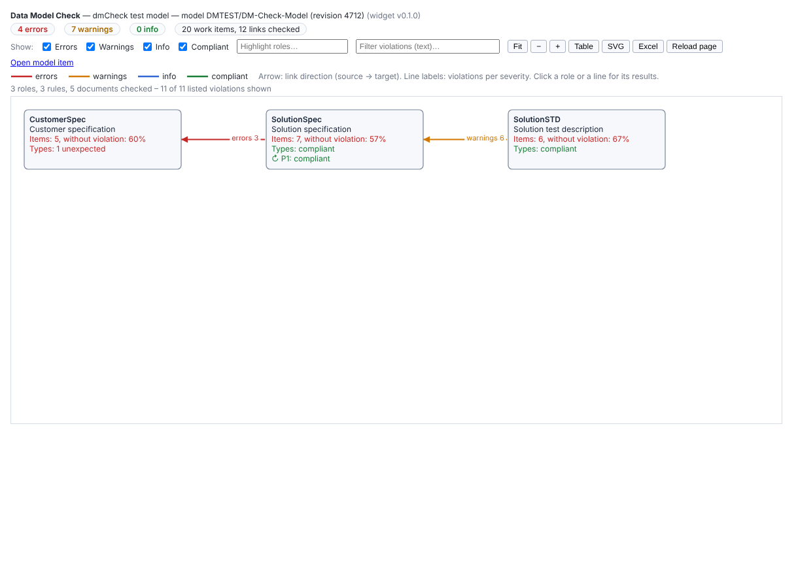

# dmCheck — installation and use

**Data Model Check** checks the documents, work items and links of the project against the data model written in a
work item (the same model as **dmDefine**: format `docs/DATA_MODEL_FORMAT.md`, examples `docs/MODELING_GUIDE.md`).
Previews below are rendered from mock data (`tools/test-widget.sh`, test structure `test-data/vcycle-check/`).

## Install (Polarion administrator)

1. Download `dmCheck-N.N.N.zip` from the releases, or take `widgets/dmCheck/dist/dmCheck.zip` from the repository.
2. **Administration → Velocity Widgets → Upload**. No server restart, no extension.
3. The widget appears in the widget list of LiveReport pages as *Data Model Check*.

Target: Polarion 2512 (0.1.0 verified on 2512, `docs/PO_CHECKS.md` §3; the 0.2.0 drill-down: checks 3.7–3.11); 2612 not verified.

## Parameters

| Parameter | Meaning |
|---|---|
| Model document | The LiveDoc holding the model work item (as in dmDefine) |
| Model work item type | Type of the model item (default Text) |
| Model work item id | Optional: the id of the model item |
| Violations listed per rule and check | At most this many violations are listed per rule and kind of check (default 500); all are counted |
| Graph height in pixels | Height of the graph area |

Put dmDefine and dmCheck on the same page (same parameters) to see the model and its check side by side.

## What is checked

Only the documents declared in the model (`bindings`) are read.

| Check | Reported when |
|---|---|
| Missing type / too many items | a document has fewer than `min` (or more than `max`) items of a type of its role (error) |
| Unexpected type | an item's type is not listed in its document's role (severity `unexpected_types`; `ignore` = not reported). Types with `ignored: true` (e.g. headings) are allowed and not counted |
| Missing link (source) | a source item of a rule has fewer than `from_min` links of the rule's link role to the target role (rule severity) |
| Not covered (target) | a target item has fewer than `to_min` such links |
| Cross-pair link | for a paired rule, a link between documents of the two roles that are not paired (it does not count) |
| Unpaired document | for a paired rule, a declared document of one of its roles in no pair |
| Unexpected link | a link of a link role used by the model, between declared documents, that matches no rule (severity `unexpected_links`; default `ignore`) |

A rule end without `type` counts the listed, not ignored types of its role. When the model has errors (as shown by
dmDefine), dmCheck lists them and checks nothing.

## Use

- **Summary**: errors, warnings, info, items and links checked; a warning when a limit (20 000 items, 40 000 links) is
  reached.
- **Graph**: one box per role (items without violation, item type results, rules inside the role), one line per pair
  of roles connected by rules, red / orange / green with the number of violations per severity. Click a line for its
  rules (counters, violations with links to the work items), a role for its documents and type results.
- **Show** checkboxes (errors, warnings, info, compliant) filter the lines and the violations; *Filter violations*
  filters the table by text.
- **Open the items in Polarion** (0.2.0): in the details of a line (missing links, targets not covered) and of a role
  (unexpected types), one row per document with the number of items: the link opens Polarion's work item table with a
  query that lists **all** those items (also those beyond the list cap), for bulk correction; *Copy query* copies the
  query, to paste into the query field of the work item table if the link does not apply it.
- **Table**: violations, rules (checked / compliant per side, cross-pair links, unpaired documents), documents,
  drill-down queries.
- **Excel**: sheets Rules, Violations (links to documents and work items), Documents, Queries, Model problems.
- **PDF export**: rules, documents and violations tables.

