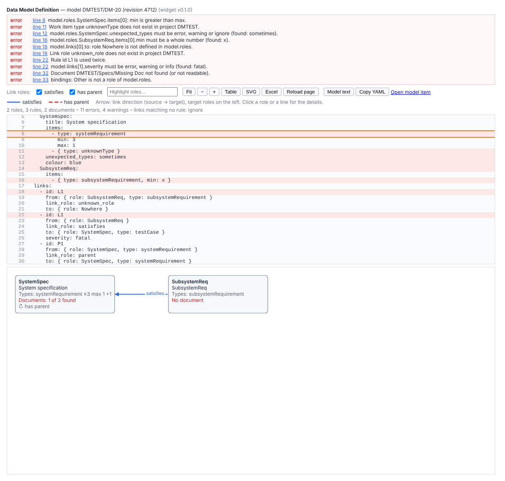
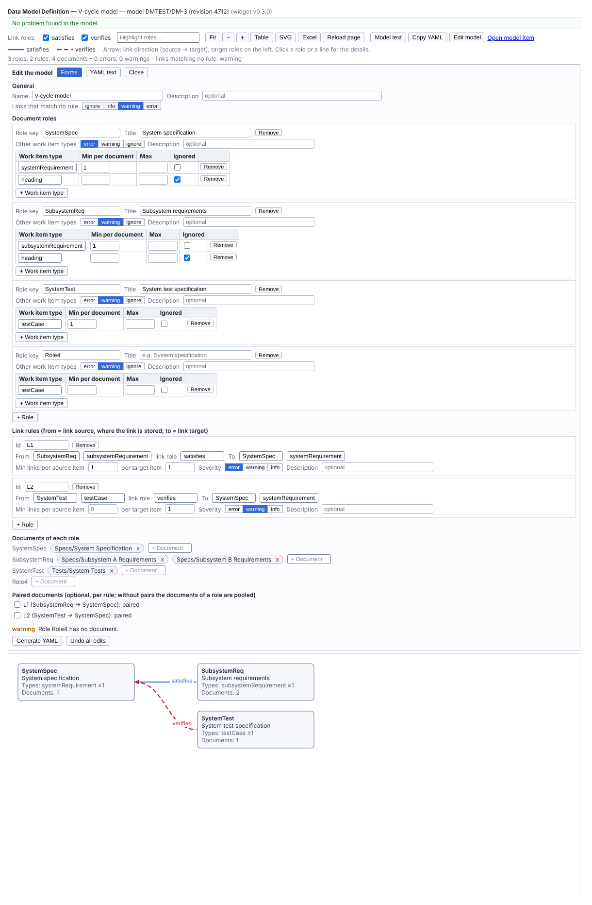

# dmDefine — installation and configuration

**Data Model Definition** shows the project data model written as YAML in a work item, and checks it against the project
configuration. Previews below are rendered from mock data (`tools/test-widget.sh`).

## Install (Polarion administrator)

1. Download `dmDefine-N.N.N.zip` from the releases, or take `widgets/dmDefine/dist/dmDefine.zip` from the repository.
2. **Administration → Velocity Widgets → Upload** (global or project scope) and choose the zip. No server restart, no
   extension: the package holds the templates, the widget icon and the Excel library (`resources/xlsx.js`).
3. The widget appears in the widget list of LiveReport pages as *Data Model Definition*.

Target: Polarion 2512 (verified with the spike widget); 2612 not verified yet.

## Prepare the model

1. Create a LiveDoc for the model, e.g. `Model/Data Model`.
2. Add a work item of type **Text** (or another type set in the widget parameters).
3. Paste the YAML model into its description **as plain text** (Ctrl+Shift+V, or copy from a plain text editor), one
   line per line. Start from `test-data/vcycle-model.yaml` and change the roles, types, link roles and documents. A title
   or comment lines above the first key (`version:`) are allowed. The format: `docs/DATA_MODEL_FORMAT.md`; examples for
   common structures (one or several documents per role, paired documents, hierarchy): `docs/MODELING_GUIDE.md`.
4. Save. Baselines of the LiveDoc keep the versions of the model.

## Add the widget to a page

| Parameter | Meaning |
|---|---|
| Model document | The LiveDoc holding the model (current project) |
| Model work item type | Type of the model item (default Text) |
| Model work item id | Optional: the id of the model item, when the document holds several items of the type |
| Graph height in pixels | Height of the graph area (default 500) |
| Graph view when the page opens | *Collapsed* (one box per role, default) or *Exploded* (one box per document inside a frame per role, pooled rules drawn from each document to the target role, pairs document to document, documents in no pair outlined in orange). The toolbar switch *View: Collapsed / Exploded* is shown when a role has several documents or a rule is paired |
| Save to Polarion (REST API) in the editor | *When available* (default) or *Off* (copy and paste only) |

The widget reads the first item of the type with a line starting with `version:`, `model:` or `uses:`.

## Use

- **Problems** (top): errors first, then warnings, each with its line; click *line N* to see it in the model text.
- **Graph**: one box per document role (types, documents found), one line per pair of roles connected by rules, arrow
  in the link direction (source → target). Click a role or a line for the details. Rules inside one role (e.g.
  `has parent`) are listed in its box.
- Rules with `pairs:` (paired documents) list their pairs in the rule details, the table view and the Excel sheet
  *Document pairs*; other rules are *pooled*.
- Toolbar: link role filters, *Highlight roles*, zoom, *Table*, *SVG*, *Excel* (roles, item types, rules, document pairs, documents,
  problems, model text), *Reload page*, *Model text*, *Copy YAML*, *Open model item*.
- To change the model: **Edit model** (0.3.0) opens a form editor prefilled with the current model: general settings,
  document roles with their work item types, link rules, documents of each role (picked from the project's documents,
  or typed as `project/space/name`), paired documents. Types, link roles and roles are chosen in search-and-pick lists.
  The forms list their problems as you edit. **Generate YAML** writes the text in the *YAML text* tab: **Copy** it, open
  the model work item, select its whole description, paste as plain text (Ctrl+Shift+V), save, *Reload page*.
  The lines above `version:` and the `description` fields are kept; comments inside the model are not (the editor says
  so). A model with errors opens in the *YAML text* tab only. With no model item yet, the forms start empty: paste the
  generated text into a new `text` work item of the model document.
- **Propose a model from the project** (0.7.0): on an empty model, *Edit model* offers to start from the project's data:
  untick the documents that are not part of the data model, then *Propose*. The forms are filled with one role per
  document (its work item types, `min: 1`; headings ignored) and one rule per link role found between the documents
  (minimums 0). Then correct it: group documents into one role, set the minimums and severities, add pairs.
- **Save to Polarion** (0.5.0): in the *YAML text* tab, when the REST API can be used from the page (session REST
  token, read access to the model item), *Save to Polarion* writes the text into the model work item directly (it asks
  first, warns when the item changed since the page was loaded, and reads it back); then *Reload page*. When it is not
  available, the line below the text says why; *Copy* and paste always work. The widget parameter *Save to Polarion*
  = Off removes it. The admin property `com.siemens.polarion.rest.security.restApiToken.enabled=true` and the user's
  REST permissions are needed (guide §8.2).
- **Reuse a model of another project** (0.4.0): a model item with `uses: "PROJECT/ID"` and its own `bindings` takes
  the roles and rules of that item (see use case 7 of `docs/MODELING_GUIDE.md`); the header names it, *Open referenced
  model* opens it. Documents of another project are written `project/space/name`.
- You can also edit the description of the model item directly (*Open model item*), save, *Reload page*.
- PDF export: tables of problems, roles and rules.

